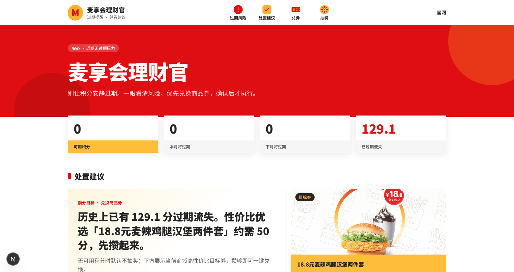
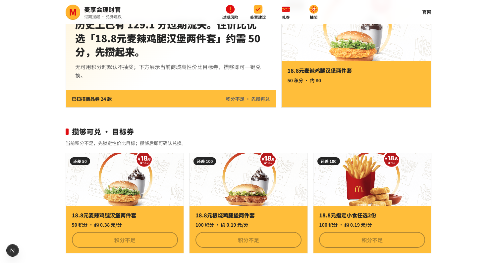
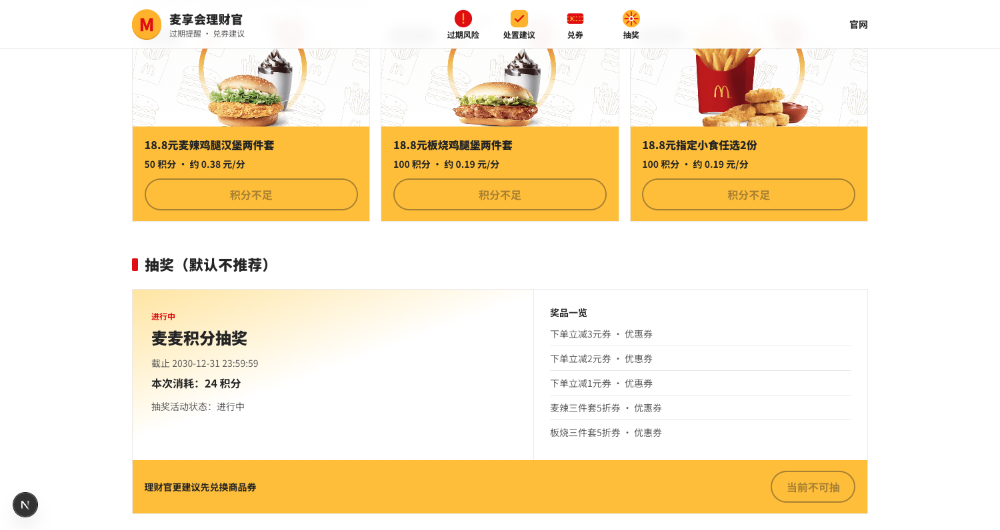

# 麦享会理财官

> 本项目为麦当劳程序员创意开发大赛参赛作品，由参赛者独立开发，非麦当劳官方产品。项目输出仅供参考；餐品信息、价格、积分与供应状态以麦当劳官方渠道的实时结果为准。

## 项目介绍

积分会过期，但很多人要到清零那天才发现。麦享会理财官基于麦当劳 MCP，把「还有多少分、本月/下月会过期多少、商城里哪张券更划算」一次算清，并默认建议先兑换商品券锁定价值；若仍想抽奖，也必须二次确认后才会真正调用 MCP。Token 只在服务端使用，浏览器不接触凭证。

一句话：盯紧过期积分，先兑券、再抽奖，你点确认才执行。

## 界面预览

本地运行 `npm run dev` 后打开 [http://localhost:3000](http://localhost:3000) 可见如下界面（截图来自真实 MCP 数据，已不含 Token / 手机号等敏感信息）。

### 过期风险一览



一眼看到可用积分、本月/下月将过期与历史流失，并给出主推兑换建议。

### 目标券推荐



按面额/积分估算性价比，列出可冲刺的目标券；积分不足时仅预览，不误触兑换。

### 抽奖二次确认入口



展示抽奖消耗与奖池，默认建议先兑券；资格不足时不可抽，有资格也需二次确认。

## 目标用户

- 麦享会会员：积分较多、不清楚何时过期、不知道兑什么划算
- 希望先兑换商品券、抽奖再自行确认的用户
- 开发者 / Skill 创作者：希望参考如何在 Next.js 中安全代理麦当劳 MCP

## 功能

- **风险一览**：可用积分、本月/下月将过期、历史已过期
- **处置建议**：扫描商品券目录，按面额/积分给出 Top 推荐
- **确认兑换**：选择 SKU → 二次确认 → `mall-create-order`
- **确认抽奖**：展示消耗后二次确认 → `draw-lottery`（默认不主动推荐）

## 技术

- Next.js App Router + TypeScript + Tailwind
- 服务端代理 [麦当劳 MCP](https://mcp.mcd.cn)，浏览器不持有 Token
- MCP 集成细节见 [MCP_INTEGRATION.md](./MCP_INTEGRATION.md)
- 参赛声明见 [CONTEST_DECLARATION.md](./CONTEST_DECLARATION.md)

## 安装与配置

### 1. 申请 MCP Token

打开 [open.mcd.cn/mcp](https://open.mcd.cn/mcp)，手机号登录后到控制台申请 **MCP Token**。

MCP 客户端配置示例见 [`mcp-config.example.json`](./mcp-config.example.json)（仅环境变量占位符，无真实密钥）。

### 2. 安装依赖

```bash
npm install
```

### 3. 配置环境变量

```bash
cp .env.example .env.local
```

编辑 `.env.local`：

```env
MCD_MCP_TOKEN=你的Token
```

可选：

```env
MCD_MCP_URL=https://mcp.mcd.cn
```

### 4. 启动

```bash
npm run dev
```

浏览器打开 [http://localhost:3000](http://localhost:3000)。

生产构建：

```bash
npm run build && npm start
```

## 使用示例

1. 打开首页，查看可用积分与过期风险色块。
2. 阅读「处置建议」中的主推商品券（按性价比排序）。
3. 在「兑券」区点选商品 → 选择 SKU → 二次确认后完成兑换。
4. 若仍想抽奖，展开抽奖区查看本次消耗 → 手动确认后才调用 `draw-lottery`。

API 自测示例：

```bash
# 聚合账户 + 建议 + 抽奖信息
curl -s http://localhost:3000/api/portfolio | jq .

# 查询商品详情（替换 spuId）
curl -s http://localhost:3000/api/mall/products/12345 | jq .

# 确认兑换（需真实 skuId / spuCategory）
curl -s -X POST http://localhost:3000/api/mall/redeem \
  -H 'Content-Type: application/json' \
  -d '{"confirm":true,"skuId":1,"spuCategory":"1","count":1}'

# 确认抽奖
curl -s -X POST http://localhost:3000/api/lottery/draw \
  -H 'Content-Type: application/json' \
  -d '{"confirm":true}'
```

## API

| 路由 | 说明 |
|------|------|
| `GET /api/portfolio` | 聚合账户、建议、抽奖、商品券目录 |
| `GET /api/mall/products/[spuId]` | 商品详情 / SKU |
| `POST /api/mall/redeem` | body: `{ confirm: true, skuId, spuCategory, count? }` |
| `POST /api/lottery/draw` | body: `{ confirm: true }` |

## 安全注意

- 写操作必须带 `confirm: true`
- 不要把 `.env.local` 或真实 Token 提交到 Git
- Token 绑定麦当劳会员身份，泄露等同账号授权
- 仓库内仅允许环境变量占位符形式的配置示例

## MVP 边界

- 不做定时推送 / 自动兑换
- 实物商品（需地址）暂不支持一键兑
- 单 Token = 当前登录会员

## 参赛材料清单

| 文件 | 说明 | 状态 |
|---|---|---|
| `README.md` | 项目介绍、安装、使用示例、目标用户 | 已具备 |
| `CONTEST_DECLARATION.md` | 官方参赛声明（内容未改动） | 已具备 |
| `MCP_INTEGRATION.md` | MCP Server / Tool / 调用流程与业务价值 | 已具备 |
| `mcp-config.example.json` | 脱敏 MCP 配置示例（仅环境变量占位符） | 已具备 |
| `src/` | 源代码 | 已具备 |
| `docs/screenshots/` | 界面预览截图 | 本地已有，待提交推送 |
| `workbuddy.md` | WorkBuddy 专项奖励用对话上下文 | 可选；未使用 WorkBuddy 可不交 |
